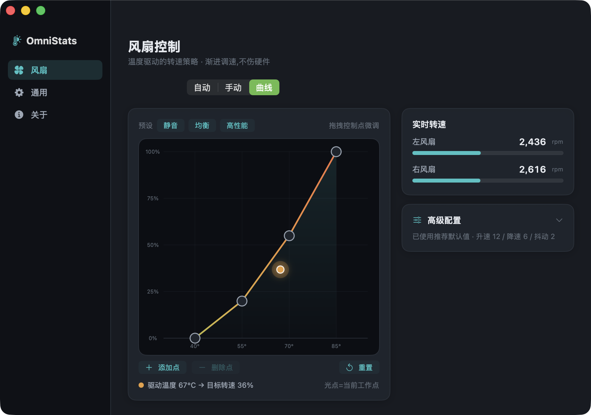
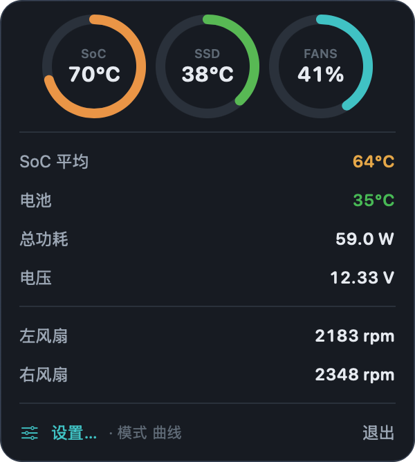
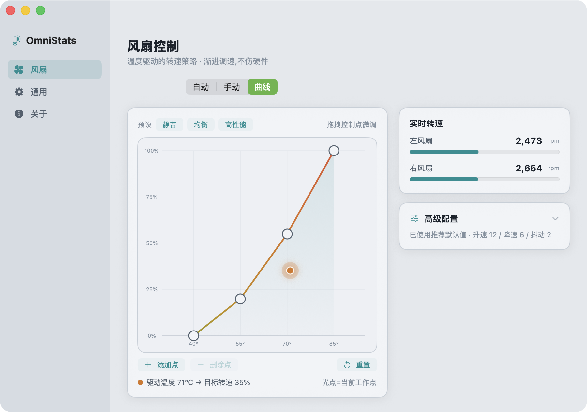

<div align="center">

# OmniStats

**A lightweight Apple Silicon menu-bar system monitor — with real fan control.**

[](https://github.com/SuooL/OmniStats/actions/workflows/ci.yml)
[](LICENSE)


English · [简体中文](README.zh-CN.md)



</div>

## What it is

OmniStats lives in your menu bar and shows SoC / SSD / battery temperatures,
power draw, and fan RPM at a glance. Unlike most monitors, it can **actually
control the fans** on Apple Silicon Macs — with a temperature→speed curve and
hardware-friendly, gradual ramping.

The dashboard also shows network throughput and CPU process rankings. Its resource
card shows CPU usage, memory, GPU utilization (where supported), and startup-disk
capacity in that order. Resource readings need no administrator permission and
stop when the panel is hidden.
Click the network row for history and per-app rates in a compact adjacent panel;
the dashboard keeps its size and position.

Verified end-to-end on **M5 Pro (Mac17,8)**. Fan control works on Apple Silicon
Macs whose firmware exposes writable fan keys (see [How fan control works](#how-fan-control-works)).

## Features

- 💻 System CPU usage, memory, GPU utilization, and startup-disk used/total capacity
- 📉 Smooth history charts that preserve sample values and real data gaps
- 🔋 Default 10 / 3 / 10 s and Eco 30 / 10 / 30 s display sampling; opening a panel uses Default
- 🌡 Menu-bar readout of the hottest SoC temperature + ring gauges
- 📈 Interactive **temperature → fan-speed curve** with a live operating point
- 🌀 **Auto / Manual / Curve** modes; per-machine fan limits handled automatically
- 🧊 **Hardware-friendly control**: EMA temperature smoothing + hysteresis
  deadband + slew-rate limiting — fans never surge on a 1° blip
- 🎛 One-click curve presets (Quiet / Balanced / Cooler)
- 🎨 Dark & light "thermal instrument" themes
- 🔒 In-app privileged-helper install (single native prompt, no Terminal)
- 🚀 Optional launch at login (General → Startup)
- 🗑 Uninstall apps together with their settings, caches, launch agents, daemons and helpers (all moved to the Trash)
- 🫥 Hide menu bar icons you rarely use behind ‹, Bartender-style, with no permissions (macOS 13–26)
- 🔋 Battery: charge, hardware charge, health (maximum capacity, cycles), and live power flow without administrator access, plus an optional charge limit with sailing mode (through the helper)
- ⬆️ Built-in update check with optional one-click self-update
- 🪶 Tiny native SwiftUI app — no Electron, no background bloat

## Screenshots

| Menu bar | Fan curve (dark) | Fan curve (light) |
|---|---|---|
|  |  |  |

## Install

### Download (recommended)

Grab the latest **`OmniStats.dmg`** from the
[Releases page](https://github.com/SuooL/OmniStats/releases/latest), open it, and
drag **OmniStats** into Applications. It isn't notarized, so the first launch is
blocked: on macOS 15 and later choose **System Settings → Privacy & Security →
Open Anyway**; on macOS 13–14 right-click the app → **Open**. Or run
`xattr -dr com.apple.quarantine /Applications/OmniStats.app`.

Releases are not notarized. From 1.6.0 they are signed with one fixed
self-signed certificate, and macOS ties the privacy permissions you grant (such
as Full Disk Access) to that signature, so they should carry over to later
updates. Earlier releases were ad-hoc signed, so the update to 1.6.0 asks for
them once more.

### Build from source

Requires the Command Line Tools (`xcode-select --install`); full Xcode not needed.

```bash
git clone https://github.com/SuooL/OmniStats.git
cd OmniStats
make
open dist/OmniStats.app
```

Source builds are signed ad-hoc (pass `SIGN_ID="<certificate name>"` to sign
with your own certificate). If Gatekeeper blocks the first launch, use **Open
Anyway** as above, or:

```bash
xattr -dr com.apple.quarantine dist/OmniStats.app
```

### Enable fan control

Click **Enable fan control** in the app and authorize once — OmniStats installs a
small root helper (LaunchDaemon) for you. No Terminal required. Remove it anytime
from **About → Remove helper**.

## How fan control works

Apple Silicon fans are governed by the SMC. OmniStats controls a fan by writing
two SMC keys as root:

| Key       | Meaning                                       |
|-----------|-----------------------------------------------|
| `F<n>md`  | mode — `0` = firmware auto, `1` = manual       |
| `F<n>Tg`  | target RPM (clamped to `F<n>Mn`…`F<n>Mx`)      |

Sequence: set `F<n>md = 1`, then write `F<n>Tg`. Note the **lowercase** `md` on
M-series Macs (older/Intel used `F0Md`); OmniStats probes both. Machines without
fans (e.g. MacBook Air) fall back to monitor-only mode.

Temperatures are read from the private `IOHIDEventSystemClient` thermal sensors;
fan RPM and power from the SMC.

## How battery charge control works

The root helper enforces the limit itself, so it keeps working while the app is
closed.

- Every 10 s, and on wake, it reads the charge from `AppleSmartBattery` and
  pauses charging at your limit by writing the SMC key `CHTE` (`CH0B`/`CH0C` on
  older firmware). Charging resumes only once the charge falls to the "resume"
  level (sailing mode), so the battery doesn't cycle around the limit.
- **macOS's own charge limit** (System Settings › Battery, macOS 26.4+) stays in
  place as a safety net. Only System Settings can change it; if your limit is
  above it, the Battery pane tells you to raise it.
- Firmware in recent updates reportedly rejects these writes (macOS 15.8 / 26.7 /
  27). On such a Mac the pane says so and points to macOS's own limit.
- Options: pause charging before sleep, and stay out of idle sleep until the
  limit is reached. **Charge to full now** lifts the limit until you unplug.
- **Heat protection** pauses charging while the battery is above a temperature
  you choose (30–50 °C) and resumes 3 °C below it, even during a full charge.
- **MagSafe LED**: leave it to macOS, show the charge state (orange while
  charging, green otherwise), or turn it off. Choosing "System" again hands it
  back to macOS.
- **Schedules** (Battery pane) repeat an action on chosen weekdays and times:
  set a limit, charge to full, or turn the limit on or off. They run while
  OmniStats is running; anything missed during sleep runs on wake (within 12 h).
- **Automation**: Shortcuts' "Open URL" action (or `open` in Terminal) can drive
  the limit. Only charge-limit actions are exposed this way:

  | Link | Action |
  |---|---|
  | `omnistats://battery/limit?value=80` | Turn the limit on at 80 % (20–100) |
  | `omnistats://battery/enable`, `…/disable` | Turn the limit on or off |
  | `omnistats://battery/topup` (`?enabled=0` to cancel) | Charge to full until unplugged |
  | `omnistats://battery/led?mode=status` (`system`, `off`) | MagSafe LED mode |
  | `omnistats://settings/battery` | Open the Battery pane |

- **Discharge & calibration** pause the power adapter (SMC `CHIE`) so a
  plugged-in Mac runs from its battery: discharge to a chosen level, keep it
  down at the limit automatically, or calibrate (full → hold 1 h → 15 % → full →
  hold 1 h → back to the limit, usually 6–10 h, every step automatic; 99 % with
  charging finished counts as full). These are deliberately not reachable from
  links or schedules.

## Uninstalling apps

**Settings → Uninstall Apps** lists the apps in /Applications and ~/Applications
(Apple's own apps excluded) and finds what each one leaves behind: data,
caches, preferences, containers, saved state, web data, launch agents and
daemons, privileged helpers and install receipts. Everything you keep ticked
goes to the Trash, so it can be restored.

- Matching is by bundle identifier first; folders that only share the app's
  name are labelled "By name", and generic or shared vendor folders (Google,
  Microsoft, "Uninstaller", …) are never matched by name. Launch daemons are
  also found by the app they point to.
- The app itself goes first; if macOS refuses (App Management), nothing else
  is touched and the pane says how to proceed.
- Items in system folders are moved by `omnistats-cleaner`, a small tool that
  runs once behind an administrator prompt. It accepts only direct children of
  a fixed set of folders, refuses symlinks and `..`, runs no shell and moves
  rather than deletes.
- Other apps' containers need Full Disk Access; without it they stay unticked.
  Ad-hoc signed builds (source builds, releases before 1.6.0) lose it on every update.
- Each uninstall writes a log to `~/Library/Logs/OmniStats`.
- **Reset…** keeps the app and moves only the selected data, caches and
  settings to the Trash; the app bundle, its launch agents, daemons, helpers
  and install receipt stay, so it starts as if freshly installed.
- Apps installed with Homebrew are labelled as such. Their cask's own cleanup
  list (`zap`) is added to the items (labelled "Homebrew"), but only paths the
  uninstaller would accept anyway: never a home or Library root, and outside
  your home folder only what `omnistats-cleaner` may move. Removing a cask app
  here leaves Homebrew's record behind, so the pane offers
  `brew uninstall --zap --cask <token>` to copy instead.
- **Leftovers of deleted apps** scans for files named after apps that are no
  longer installed (or known to Launch Services anywhere else). Only
  reverse-DNS names count; anything belonging to an installed app or another
  app from the same vendor, SDK and system data (Amplitude, Crashlytics, CUPS,
  Swift PM, …) and command-line tools' settings are left out, and launch jobs
  count only when their program is gone. Nothing is ticked until you review
  it.

## Menu bar icons

**Settings → Menu Bar Icons** (off by default) adds a ‹ control and a | divider
next to OmniStats' icon. Hold ⌘ and drag the icons you rarely use to the left
of the divider; click ‹ (or press your shortcut) to show them, and they hide
again after the delay you choose. An optional dashed divider adds an
always-hidden section, revealed by ⌥-clicking or right-clicking ‹.

- It works like Hidden Bar: when hidden, the divider widens to push everything
  to its left off-screen. No Accessibility or Screen Recording permission is
  involved, so updates never affect it.
- If the divider ends up right of ‹, OmniStats refuses to hide (so ‹ can't
  vanish) and the pane asks you to drag it back.
- macOS 27 rebuilt the menu bar and drops over-wide items, so the feature is
  unavailable there for now.

## Hardware-friendly control

Fan speed is never yanked around. Three layers keep it smooth:

1. **Temperature smoothing** — the driving temperature is an exponential moving
   average (~6 s), so brief spikes don't make fans surge.
2. **Hysteresis deadband** — if the new target is within a small band of the
   current command, nothing changes (no constant micro-adjusting).
3. **Slew-rate limiting** — when it does change, the commanded speed moves by a
   bounded step per second, ramping gradually.

All three are tunable under **Fans → Advanced**, with a one-click restore.

## Safety & security

- Targets are clamped to each fan's own `Mn`…`Mx` range.
- A **watchdog** reverts every fan to firmware auto if the app disconnects or
  hangs; quitting the app also reverts.
- Only the tiny `omnistats-smcd` helper runs as root; it verifies the peer uid so
  other local accounts can't hijack your fans. When the helper is signed with a
  certificate, it also checks the connecting app's code signature, so only
  OmniStats signed with the same certificate can send it commands. Releases are
  certificate-signed from 1.6.0; ad-hoc builds (source builds, older releases)
  rely on the console-user check.
- Charge control fails towards charging: the helper allows charging again when
  it exits (uninstall, shutdown), when the battery can't be read, and when the
  limit is turned off. It writes nothing while another charge manager (AlDente,
  batt, Battery Toolkit) is running, and never touches the charging keys unless
  you turn the limit on.
- Pausing the adapter is the one control that could drain a plugged-in Mac, so
  OmniStats restores it the moment you unplug (SMC `AC-W` tells a real unplug
  from its own pause), before the Mac sleeps, when the target, a 10 % floor or
  an 8-hour limit is reached, when the battery can't be read, when another
  charge manager appears, and whenever the helper starts or stops.

## Updates

**About → Software update** checks GitHub Releases and can download & install a
newer build in place. Releases are produced by tagging `vX.Y.Z` (see
[CONTRIBUTING](CONTRIBUTING.md)).

## Roadmap

- [x] Network throughput module
- [x] CPU process rankings, GPU utilization and system memory
- [x] Startup-disk capacity
- [ ] Disk activity & battery health
- [ ] Per-fan independent curves
- [ ] Homebrew cask

## Contributing

Branch workflow is `feature/*` → `dev` → `main`. See [CONTRIBUTING.md](CONTRIBUTING.md).

## License

[MIT](LICENSE)
